<p align="center">
  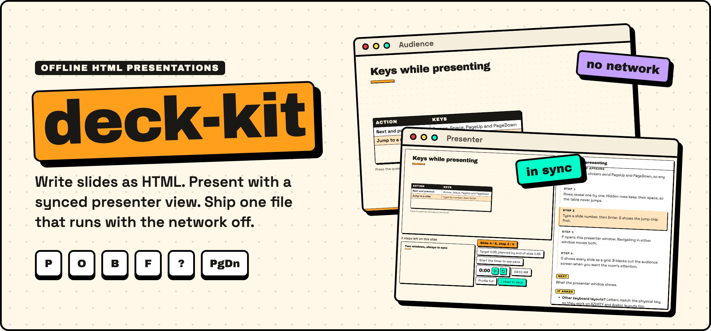
</p>

<p align="center">
  <a href="#start-a-new-talk"><b>Start a new talk</b></a> ·
  <a href="#examples">Examples</a> ·
  <a href="#features">Features</a> ·
  <a href="#keys">Keys</a> ·
  <a href="#on-the-day">On the day</a> ·
  <a href="docs/authoring.md">Authoring reference</a>
</p>

<p align="center">
  
  
  
  
  
  
</p>

An offline, self-hosted HTML presentation kit with a real presenter view. You write each slide
as a small HTML file, and the engine does the rest: keyboard and clicker control, step-by-step
builds, a synced presenter window with your script and a pace timer, an overview grid, blackout,
print to PDF, and a single-file build that runs from a USB stick with Wi-Fi off.

It ships with **Claude Code skills** that take a new talk from a topic to a finished,
fact-checked, designed deck, stopping for your review after every phase.

<p align="center">
  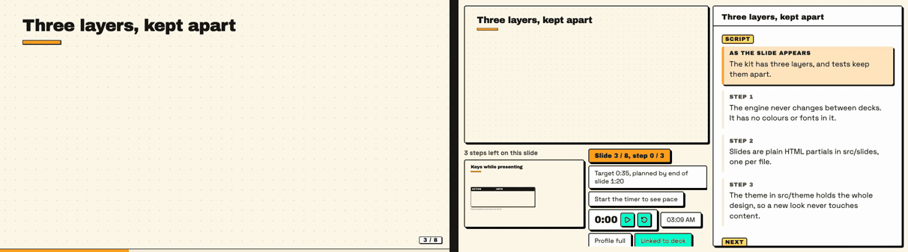
  <br><sub>Audience window (left) and presenter (right). Either one drives the other.</sub>
</p>

## Start a new talk

```sh
# 1. On GitHub: "Use this template", then clone your copy
pnpm install
pnpm dev            # http://localhost:5173, plus /presenter.html for the presenter view
```

The starter deck that opens demonstrates every slide type and feature. To make your own talk,
open Claude Code in the folder and run:

```
/new-deck
```

<p align="center">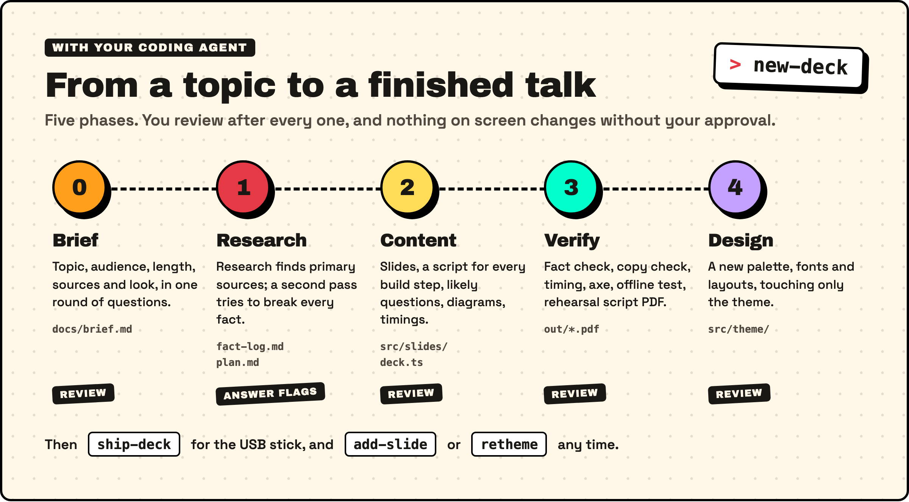</p>

| Skill | What it does |
|---|---|
| `/new-deck` | The whole talk in five phases. Research is done by subagents and then checked by a second, adversarial pass. On-screen content never changes without your approval. |
| `/add-slide` | Adds or reworks one slide, with notes, build steps, timings and checks. |
| `/retheme` | Gives the deck a new look (palette, fonts, layouts, diagrams, presenter). Only the theme changes. |
| `/ship-deck` | Runs every check, builds `deck.html`, the PDFs and your script, and lists what to put on the USB stick. |

No Claude? Slides are plain HTML: copy one from `src/slides/`, add it to `src/deck.ts`, and
follow [`docs/authoring.md`](docs/authoring.md).

## Examples

Two complete talks ship in [`examples/`](examples/), each with its own content, notes and
design on the same engine. Run them with `pnpm dev:example` and `pnpm dev:example:crypto`.

### Wireless Networks by Coverage and the Evolution of Wi-Fi

A 12:40 course talk with an 8:50 cut (CENG645 Mobile Communication), in a neo-brutalist look: cream paper,
ink borders, hard shadows, Archivo Black. It is also the fixture the engine's browser tests run
against.

<table>
  <tr>
    <td width="50%">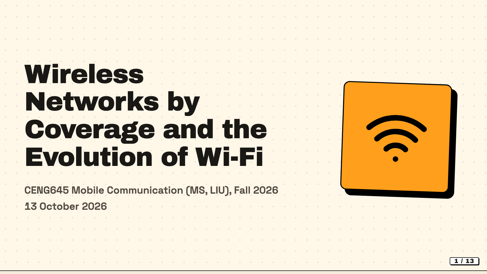</td>
    <td width="50%">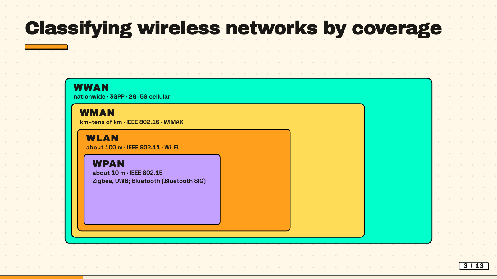</td>
  </tr>
  <tr>
    <td>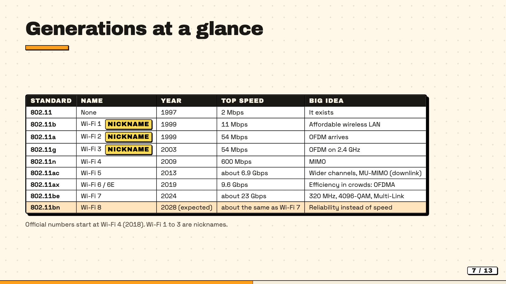</td>
    <td>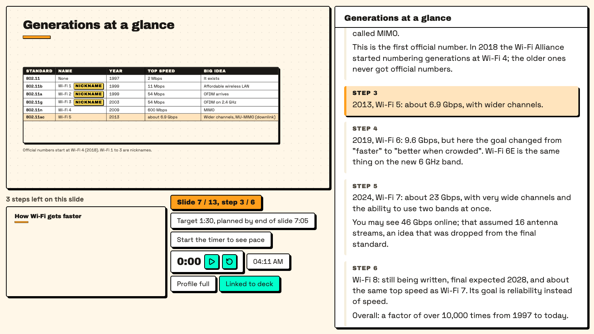</td>
  </tr>
</table>

### The Key Is the Only Secret

A talk on Chapter 1 of Paar and Pelzl, *Understanding Cryptography*, made end to end with
`/new-deck` as a test of the kit. The design is a cryptanalyst's notebook: graph paper, a red
margin, fountain-pen navy, red-pencil notes and typewriter ciphertext (Fraunces, IBM Plex Mono,
Caveat). The title arrives encrypted and decrypts on the first click; the ciphertext on slide 2
is broken with letter frequencies on slide 7. Its brief, plan, decisions and fact log are in
[`examples/crypto/docs/`](examples/crypto/docs/).

<table>
  <tr>
    <td width="50%">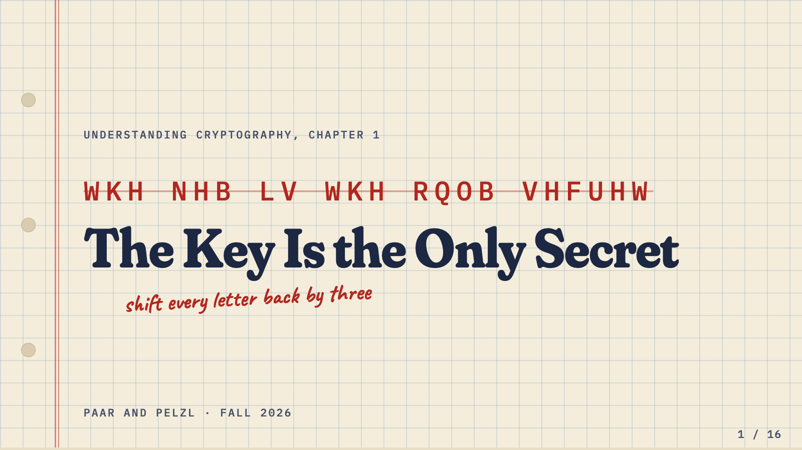</td>
    <td width="50%">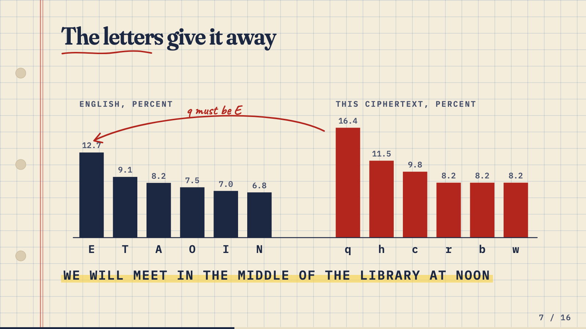</td>
  </tr>
  <tr>
    <td>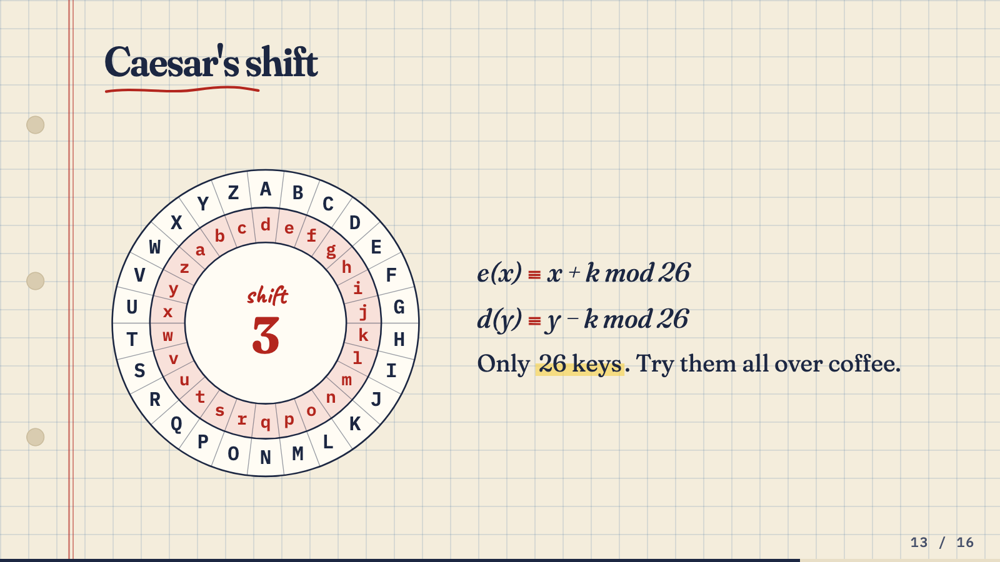</td>
    <td>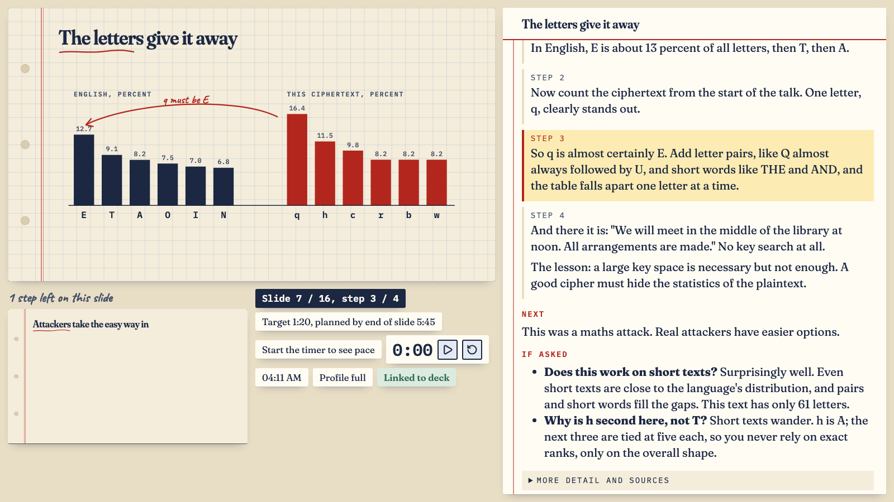</td>
  </tr>
</table>

## Features

<table>
  <tr>
    <td width="50%">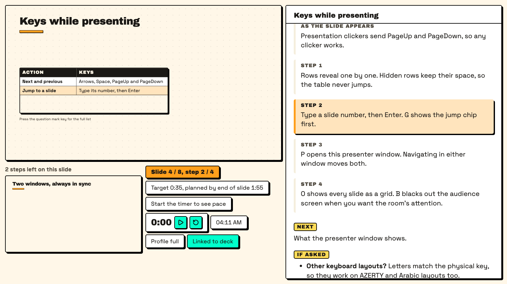</td>
    <td width="50%">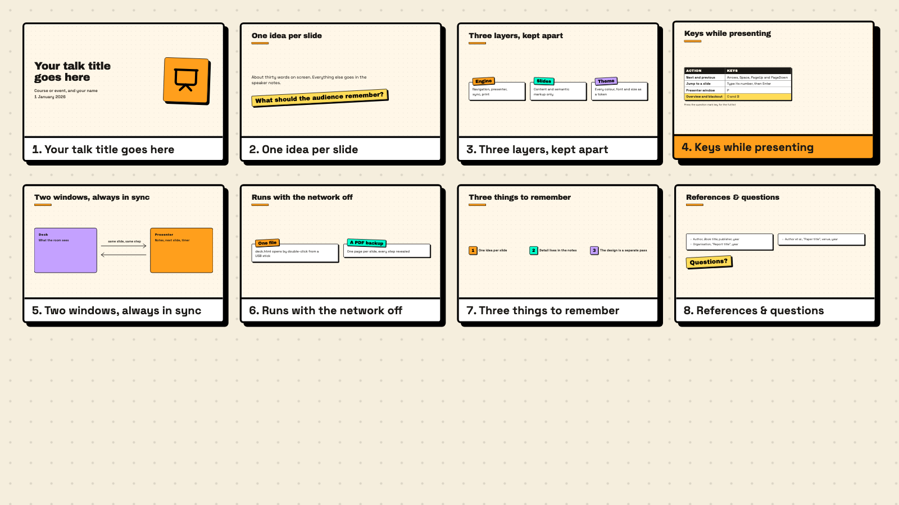</td>
  </tr>
  <tr>
    <td><b>Presenter window (P).</b> The current slide at its live step and the next slide. Your script, with the block for this step highlighted, plus a Next line, acronyms and likely questions. An elapsed timer that survives a refresh, the wall clock, and ahead or behind against each slide's target time.</td>
    <td><b>Overview (O).</b> Every slide as a grid of live thumbnails. Arrows move, Enter or a click jumps. The clicker moves the selection, not the deck.</td>
  </tr>
  <tr>
    <td>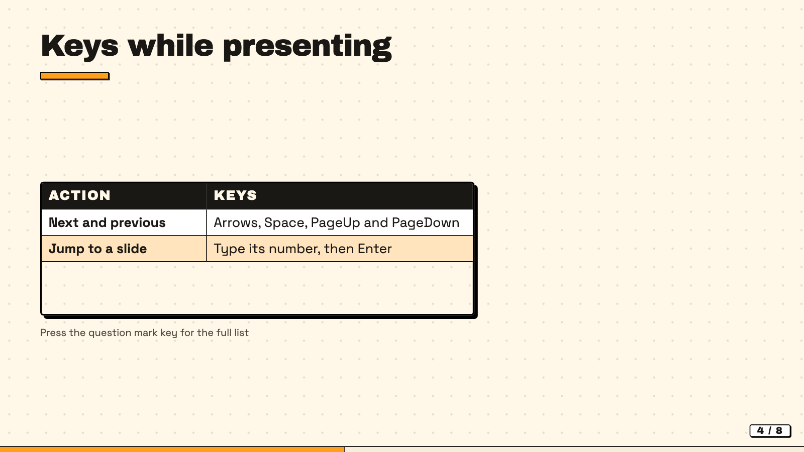</td>
    <td>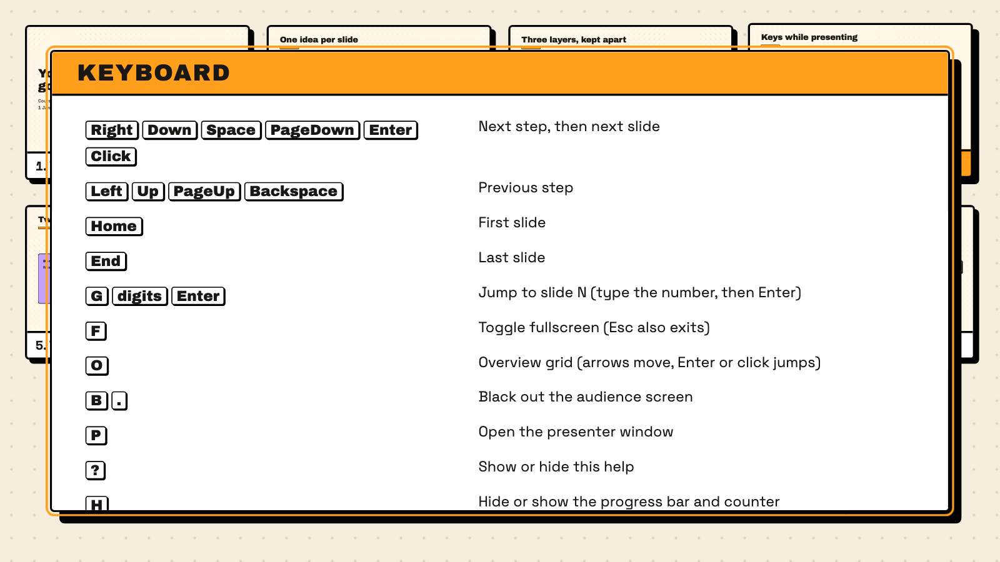</td>
  </tr>
  <tr>
    <td><b>Build steps.</b> Rows, cards and diagram parts appear in order. Hidden items keep their space, so nothing jumps. The URL keeps your place (<code>#/4/2</code>), so refresh and the back button just work.</td>
    <td><b>Help (?).</b> Generated from the same keymap the engine uses, so it never goes out of date.</td>
  </tr>
</table>

<p align="center">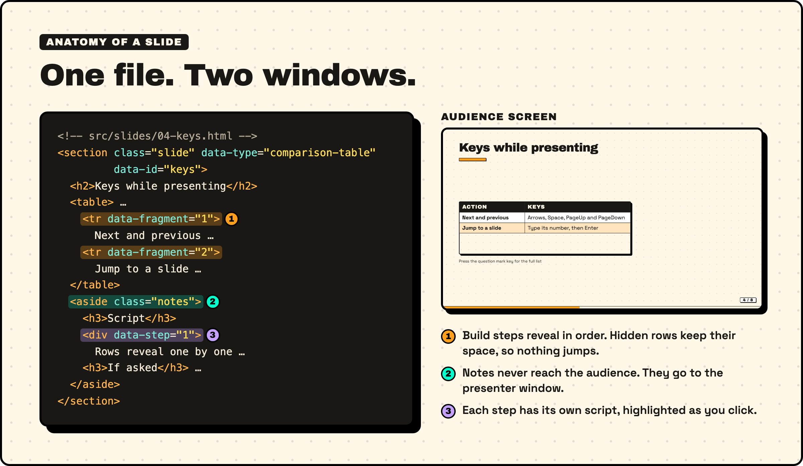</p>

- **Fixed 1920x1080 canvas**, scaled to any screen with letterboxing. Layouts never reflow.
- **Two-way sync** over BroadcastChannel, with a `window.opener` fallback so it also works from
  `file://` in Firefox.
- **Profiles**: several versions of one talk (`?profile=short`), each with its own slide order
  and timings, plus backup slides after the end.
- **Blackout** (B), **jump** to any slide, **hide chrome** (H), **fullscreen** (F), and swipe
  on touch screens.
- **Print**: Ctrl/Cmd+P gives one slide per page with every step shown. `pnpm pdf` does this
  for each profile, and `pnpm notes:pdf` prints your script, one A4 page per slide.
- **Accessible**: a live region announces each slide, hidden slides are inert, and axe checks
  every slide in the test suite.
- **No framework**: vanilla TypeScript and DOM; the starter deck is about 15 kB of JavaScript gzipped, slides and icons included.

<p align="center">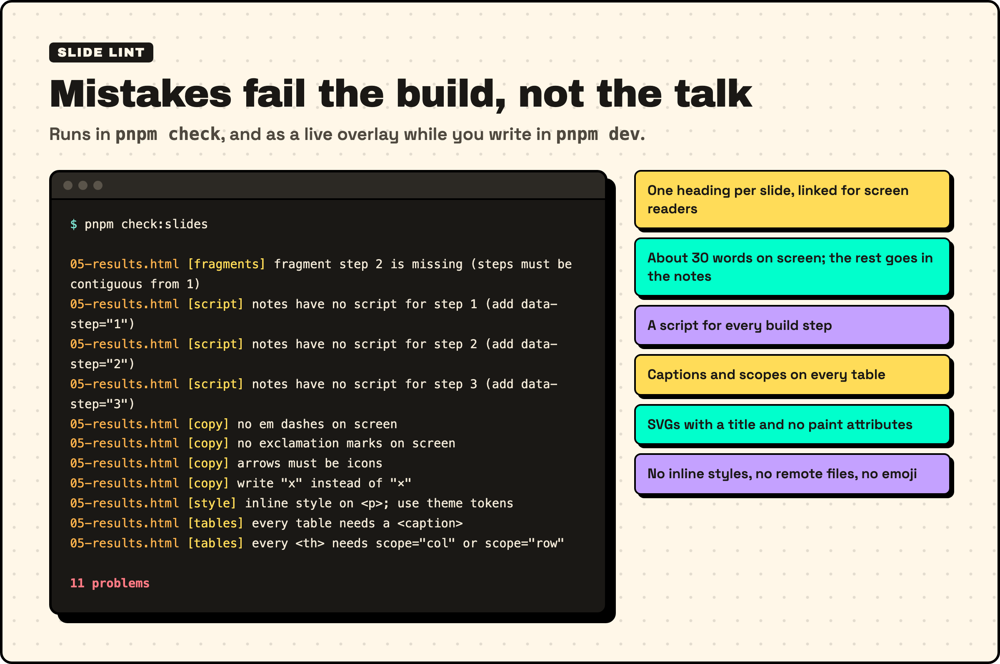</p>

## Keys

<p align="center">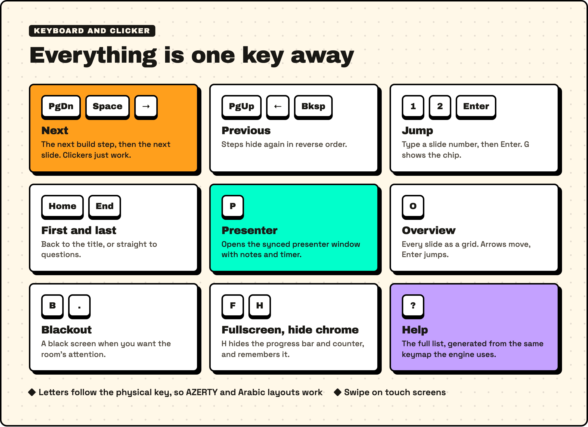</p>

| Action | Keys |
|---|---|
| Next | Right, Down, Space, PageDown, Enter, left click, swipe left |
| Previous | Left, Up, PageUp, Backspace, swipe right |
| First / last | Home / End |
| Jump | type the slide number, then Enter (G shows the chip) |
| Fullscreen | F (Esc also exits) |
| Overview | O (arrows move, Enter or click jumps) |
| Blackout | B or . |
| Presenter | P |
| Help | ? |
| Hide chrome | H (remembered across reloads) |

Letters match the physical key, so they work on AZERTY and Arabic layouts. Ctrl, Cmd and Alt
shortcuts go to the browser. Clickers send PageUp/PageDown, so they work out of the box.

## On the day

<p align="center">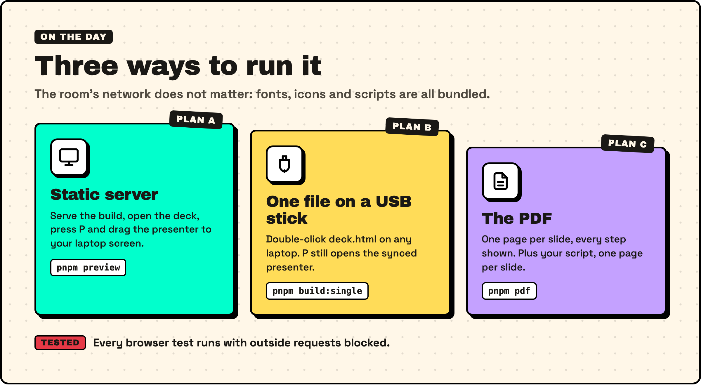</p>

1. **`pnpm preview`**, or any static server on `dist/` (for example
   `python3 -m http.server -d dist`). Open the deck and press **P** for the presenter window.
2. **`dist-single/deck.html` from a USB stick.** Double-click it, and **P** opens
   `deck.html?role=presenter`. Sync works on `file://` in Chrome and Safari, and in Firefox
   through the opener fallback.
3. **The PDF** from `pnpm pdf`.

A plain `dist/index.html` opened by double-click will not run, because browsers block module
scripts on `file://`. Use option 1 or 2.

## How it is built

<p align="center">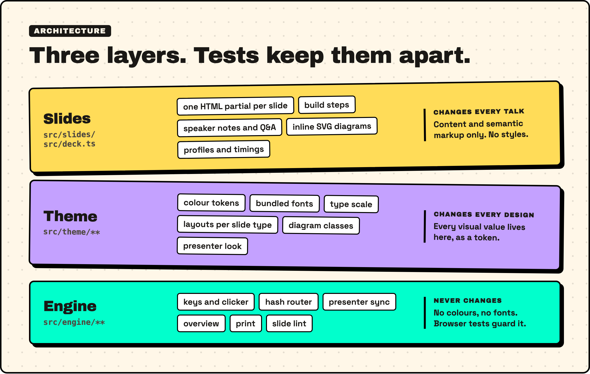</p>

```
src/
  engine/        the engine: never edited per deck; no visual values (a test enforces it)
  slides/        one HTML partial per slide: content and semantic markup only
  theme/         every visual value, as tokens; the design pass touches only this
  assets/        icons.ts: the lucide icon whitelist
  deck.ts        slide order, profiles, target times
examples/        two complete decks: wifi (also the engine's e2e fixture) and crypto
docs/            authoring.md, templates/, media/, and per deck: brief, decisions, plan, fact log
.claude/skills/  new-deck, add-slide, retheme, ship-deck
```

Two browser test suites run with every outside request blocked:
- **engine**: the full engine contract (keys, fragments, router, sync, presenter, print,
  offline, axe) in Chromium and WebKit. It runs against the example deck, so it never depends on
  your slides.
- **deck**: your own slides. Every slide must fit the canvas, pass axe, print one page per
  slide, and run from `deck.html` offline.

Stack: pnpm, Vite 8, strict TypeScript 7, vanilla DOM, Biome, Vitest, Playwright. No UI
framework and no presentation library. Node 22.12 or later.

## Commands

| Command | What it does |
|---|---|
| `pnpm dev` | Authoring server with live reload and the slide-lint overlay |
| `pnpm dev:example` | The Wi-Fi example deck |
| `pnpm dev:example:crypto` | The cryptography example deck |
| `pnpm build` | Static multi-page build in `dist/` (deck and `presenter.html`) |
| `pnpm build:single` | One self-contained `dist-single/deck.html` that opens by double-click |
| `pnpm preview` | Serves `dist/` on http://127.0.0.1:4175 |
| `pnpm check` | Typecheck, Biome lint, unit tests, slide lint |
| `pnpm test:deck` | Your deck in a real browser: fits the canvas, axe, print, offline |
| `pnpm test:engine` | The engine contract, run against the example deck |
| `pnpm test:e2e` | Both suites |
| `pnpm shots [profile]` | Screenshots of every slide and the presenter in `out/shots/` |
| `pnpm pdf` | `out/deck-<profile>.pdf` for every profile |
| `pnpm notes:pdf [profile]` | `out/presenter-script-<profile>.pdf` |
| `pnpm notes:md` | `docs/presenter-script.md` |
| `pnpm media` | Regenerates the images in this README (needs ffmpeg for the GIF) |

First run of the browser tests: `pnpm exec playwright install chromium webkit`.

## Credits

The example decks were made for university courses at LIU, Fall 2026: "Wireless Networks by
Coverage and the Evolution of Wi-Fi" (CENG645 Mobile Communication) and "The Key Is the Only
Secret" (Chapter 1 of Paar and Pelzl, *Understanding Cryptography*, Springer 2010; the book's
text is not included). Fonts: Archivo Black, Space Grotesk, Fraunces,
IBM Plex Mono and Caveat (SIL OFL 1.1) through Fontsource. Icons: Lucide (ISC). MIT licensed.
